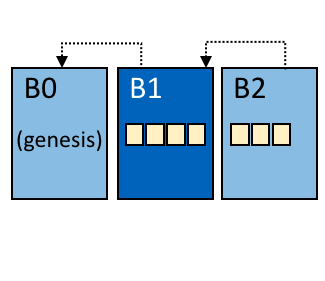
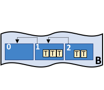
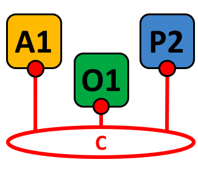
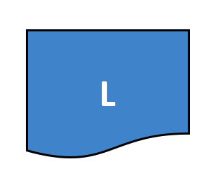
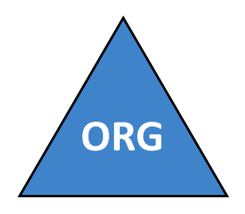
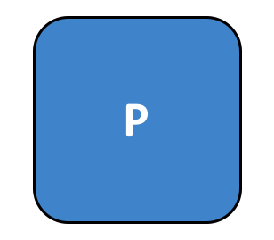
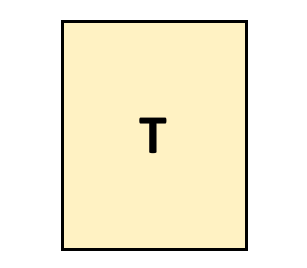
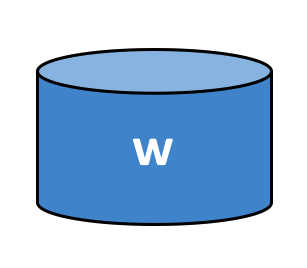

Atamalar lug'ati
===========================

Atamalar muhim, chunki Hyperledger Fabric'ning barcha foydalanuvchilari va
dasturchilari har bir atama bilan nimani nazarda tutayotganimizni bir xil
tushunishi kerak. Masalan, smart-kontrakt nima? Hujjatlar zarur joylarda ushbu
lug'atga havola beradi, lekin xohlasangiz, uni boshidan oxirigacha bir o'tirishda
o'qib chiqishingiz mumkin — bu ancha foydali!

.. _Anchor-Peer:

Tayanch peer (Anchor Peer)
--------------------------

Gossip protokoli undan turli tashkilotlardagi peer'lar bir-biri haqida
bilishini ta'minlash uchun foydalanadi.

Tayanch peer'lar bo'yicha yangilanishni o'z ichiga olgan konfiguratsiya bloki
qayd etilganda, peer'lar tayanch peer'larga murojaat qiladi va ulardan tayanch
peer(lar)ga ma'lum bo'lgan barcha peer'lar haqida bilib oladi. Har bir
tashkilotdan kamida bitta peer tayanch peer bilan bog'langach, tayanch peer
kanaldagi har bir peer haqida bilib oladi. Gossip aloqasi uzluksiz bo'lgani va
peer'lar o'zlariga noma'lum bo'lgan har qanday peer mavjudligi haqida doim
so'raganligi sababli, kanal uchun a'zolik haqida umumiy tasavvur shakllanishi
mumkin.

Masalan, kanalda uchta tashkilot — ``A``, ``B``, ``C`` — bor va ``C``
tashkiloti uchun bitta tayanch peer — ``peer0.orgC`` — belgilangan deylik.
``peer1.orgA`` (``A`` tashkilotidan) ``peer0.orgC`` bilan bog'langanda, u
``peer0.orgC``'ga ``peer0.orgA`` haqida xabar beradi. Keyinroq ``peer1.orgB``
``peer0.orgC`` bilan bog'langanda, ``peer0.orgC`` unga ``peer0.orgA`` haqida
xabar beradi. Shu paytdan boshlab ``A`` va ``B`` tashkilotlari ``peer0.orgC``
yordamisiz a'zolik ma'lumotlarini to'g'ridan-to'g'ri almasha boshlaydi.

Tashkilotlar o'rtasidagi aloqa ishlashi uchun gossip'ga bog'liq bo'lgani sababli,
kanal konfiguratsiyasida kamida bitta tayanch peer belgilangan bo'lishi kerak.
Uzluksiz ishlash (high availability) va zaxira uchun har bir tashkilot o'zining tayanch
peer'lar to'plamini taqdim etishi qat'iy tavsiya etiladi.

.. _glossary_ACL:

ACL
---

ACL yoki kirishni boshqarish ro'yxati (Access Control List) muayyan peer
resurslariga (masalan, tizim chaincode API'lari yoki hodisalar xizmatlariga)
kirishni `siyosat <Policy_>`__ bilan bog'laydi. Siyosat qancha va qanday turdagi
tashkilotlar yoki rollar talab qilinishini belgilaydi. ACL kanal
konfiguratsiyasining bir qismi. Shu sababli u kanalning konfiguratsiya
bloklarida saqlanadi va konfiguratsiyani yangilashning standart mexanizmi
orqali yangilanishi mumkin.

ACL kalit-qiymat juftliklari ro'yxati shaklida bo'ladi: kalit biz kirishni
boshqarmoqchi bo'lgan resursni, qiymat esa unga kirishga ruxsat berilgan kanal
siyosatini (guruhini) bildiradi. Masalan,
``lscc/GetDeploymentSpec: /Channel/Application/Readers``
hayot sikli chaincode'ining ``GetDeploymentSpec`` API'siga (resursga)
``/Channel/Application/Readers`` siyosatini qondiradigan raqamli shaxslar (identity) kira
olishini belgilaydi.

Sukut bo'yicha ACL'lar to'plami ``configtx.yaml`` faylida berilgan. Bu fayldan
configtxgen kanal konfiguratsiyalarini yaratish uchun foydalanadi. Sukut
bo'yicha qiymatlarni ``configtx.yaml`` faylining yuqori darajadagi "Application"
bo'limida belgilash yoki "Profiles" bo'limida har bir profil uchun alohida
qayta belgilash mumkin.

.. _Block:

Blok (Block)
------------

   B1 bloki B0 blokiga bog'langan. B2 bloki B1 blokiga bog'langan.

=======

Blok tartiblangan tranzaksiyalar to'plamini o'z ichiga oladi. U oldingi blok
bilan kriptografik tarzda bog'langan va o'z navbatida keyingi bloklar bilan
bog'lanadi. Bunday bloklar zanjiridagi birinchi blok **boshlang'ich blok**
(genesis block) deb ataladi. Bloklarni tartiblash xizmati yaratadi, so'ngra
peer'lar ularni validatsiyadan o'tkazadi va qayd etadi.

.. _Chain:

Zanjir (Chain)
--------------

   B blokcheyni 0, 1, 2 bloklarini o'z ichiga oladi.

=======

Reestr zanjiri — bu tranzaksiyalarning xesh orqali bog'langan bloklari
ko'rinishida tuzilgan tranzaksiyalar jurnali. Peer'lar tranzaksiya bloklarini
tartiblash xizmatidan oladi, tasdiqlash siyosatlari va parallellik
buzilishlari asosida blokdagi tranzaksiyalarni yaroqli yoki yaroqsiz deb
belgilaydi va blokni peer fayl tizimidagi xesh zanjiriga qo'shadi.

.. _chaincode:

Chaincode
---------

Qarang: `Smart-kontrakt <Smart-Contract_>`__.

.. _Channel:

Kanal (Channel)
---------------

   C kanali A1 ilovasini, P2 peer'ini va O1 tartiblash xizmatini bog'laydi.

=======

Kanal — ma'lumotlarni ajratish va konfidensiallikni ta'minlaydigan, blokcheyn
ustidagi yopiq (private) qatlam. Kanalga xos reestr kanaldagi peer'lar uchun
umumiy bo'ladi, tranzaksiya amalga oshiruvchi tomonlar esa kanal bilan o'zaro ishlash
uchun unda autentifikatsiyadan o'tgan bo'lishi kerak. Kanallar
`konfiguratsiya bloki <Configuration-Block_>`__ orqali belgilanadi.

.. _Commit:

Qayd etish (Commit)
-------------------

Kanaldagi har bir Peer_ tartiblangan tranzaksiya bloklarini validatsiyadan
o'tkazadi, so'ngra bloklarni kanal `reestrining <Ledger_>`__ o'z nusxasiga qayd etadi (yozadi/qo'shadi).
Peer'lar, shuningdek, har bir blokdagi har bir tranzaksiyani yaroqli yoki
yaroqsiz deb belgilaydi.

.. _Concurrency-Control-Version-Check:

Parallellikni boshqarish bo'yicha versiya tekshiruvi (Concurrency Control Version Check)
---------------------------------------------------------------------------------------------

Parallellikni boshqarish bo'yicha versiya tekshiruvi — kanaldagi peer'lar
o'rtasida reestr holatini sinxron saqlash usuli. Peer'lar tranzaksiyalarni
parallel ravishda bajaradi va reestrga qayd etishdan oldin tranzaksiya
bajarilgan paytda o'qilgan holat bajarilish vaqtida hali qayd etilmagan yangi blokda
yoki xuddi shu blokdagi oldingi tranzaksiyada o'zgartirilgan-o'zgartirilmaganini
tekshiradi. Agar tranzaksiya uchun o'qilgan ma'lumotlar bajarilish va qayd etish
vaqti oralig'ida o'zgargan bo'lsa, parallellikni boshqarish bo'yicha versiya
tekshiruvi buzilgan hisoblanadi: tranzaksiya reestrda yaroqsiz deb belgilanadi
va holat ma'lumotlar bazasidagi qiymatlar yangilanmaydi.

.. _Configuration-Block:

Konfiguratsiya bloki (Configuration Block)
------------------------------------------

Tizim zanjiri (tartiblash xizmati) yoki kanal uchun a'zolar va siyosatlarni
belgilaydigan konfiguratsiya ma'lumotlarini o'z ichiga oladi. Kanal yoki butun
tarmoq konfiguratsiyasidagi har qanday o'zgarish (masalan, a'zoning chiqib
ketishi yoki qo'shilishi) tegishli zanjirga yangi konfiguratsiya bloki
qo'shilishiga olib keladi. Bu blok boshlang'ich blok tarkibini va unga
nisbatan o'zgarishlarni o'z ichiga oladi.

.. _Consensus:

Konsensus (Consensus)
---------------------

Butun tranzaksiya oqimini qamrab oladigan kengroq atama. U blokni tashkil
etuvchi tranzaksiyalar to'plamining tartibi bo'yicha kelishuvga erishish va
uning to'g'riligiga ishonch hosil qilish uchun xizmat qiladi.

.. _Consenter-Set:

Konsensus ishtirokchilari to'plami (Consenter set)
--------------------------------------------------

Raft tartiblash xizmatida bular kanaldagi konsensus mexanizmida faol ishtirok
etayotgan tartiblovchi tugunlardir. Agar tizim kanalida boshqa tartiblovchi
tugunlar mavjud bo'lsa-yu, lekin ular kanal tarkibiga kirmasa, ular o'sha
kanalning konsensus ishtirokchilari to'plamiga kirmaydi.

.. _Consortium:

Konsorsium (Consortium)
-----------------------

Konsorsium — blokcheyn tarmog'idagi orderer bo'lmagan tashkilotlar to'plami.
Bular kanallarni tashkil qiladigan, ularga qo'shiladigan va peer'larga egalik
qiladigan tashkilotlardir. Blokcheyn tarmog'ida bir nechta konsorsium bo'lishi
mumkin bo'lsa-da, aksariyat blokcheyn tarmoqlarida bitta konsorsium bo'ladi.
Kanal yaratilayotganda kanalga qo'shilgan barcha tashkilotlar konsorsium tarkibida
bo'lishi kerak. Biroq konsorsiumda belgilanmagan tashkilot mavjud kanalga
qo'shilishi mumkin.

.. _Chaincode-definition:

Chaincode ta'rifi (Chaincode definition)
----------------------------------------

Chaincode ta'rifidan tashkilotlar chaincode kanalda ishlatilishidan oldin uning
parametrlari bo'yicha kelishib olish uchun foydalanadi. Tranzaksiyalarni
tasdiqlash yoki reestrga so'rov yuborish uchun chaincode'dan foydalanmoqchi
bo'lgan har bir kanal a'zosi o'z tashkiloti uchun chaincode ta'rifini ma'qullashi
kerak. Yetarli miqdordagi kanal a'zolari hayot sikli tasdiqlash siyosatini
(Lifecycle Endorsement policy; sukut bo'yicha kanaldagi tashkilotlarning
ko'pchiligi) qondiradigan darajada chaincode ta'rifini ma'qullagach, chaincode
ta'rifi kanalga qayd etilishi mumkin. Ta'rif qayd etilgandan so'ng chaincode'ning
birinchi chaqiruvi (yoki, so'ralgan bo'lsa, Init funksiyasining bajarilishi)
kanalda chaincode'ni ishga tushiradi.

.. _Dynamic-Membership:

Dinamik a'zolik (Dynamic Membership)
------------------------------------

Hyperledger Fabric butun tarmoqning ishlashiga zarar yetkazmasdan a'zolar,
peer'lar va tartiblash xizmati tugunlarini qo'shish va olib tashlashni
qo'llab-quvvatlaydi. Biznes munosabatlari o'zgarganda va turli sabablarga ko'ra
subyektlarni qo'shish yoki olib tashlash kerak bo'lganda dinamik a'zolik juda
muhim.

.. _Endorsement:

Tasdiqlash (Endorsement)
------------------------

Muayyan peer tugunlar chaincode tranzaksiyasini bajarib, mijoz ilovasiga
taklifga javob (proposal response) qaytaradigan jarayon. Taklifga javob
chaincode bajarilishi javob xabarini, natijalarni (o'qish to'plami va yozish
to'plami) va hodisalarni, shuningdek peer chaincode'ni bajarganini isbotlovchi
imzoni o'z ichiga oladi. Chaincode ilovalarining tegishli tasdiqlash siyosatlari
bo'ladi, ularda tasdiqlovchi peer'lar ko'rsatiladi.

.. _Endorsement-policy:

Tasdiqlash siyosati (Endorsement policy)
----------------------------------------

Kanaldagi qaysi peer tugunlar muayyan chaincode ilovasiga biriktirilgan
tranzaksiyalarni bajarishi kerakligini va javoblarning (tasdiqlarning) talab
qilinadigan birikmasini belgilaydi. Siyosat tranzaksiyaning tasdiqlovchi
peer'larning belgilangan minimal soni, tasdiqlovchi peer'larning minimal foizi yoki muayyan
chaincode ilovasiga tayinlangan barcha tasdiqlovchi peer'lar tomonidan
tasdiqlanishini talab qilishi mumkin. Siyosatlar ilovaga va tasdiqlovchi
peer'larning (ataylab yoki tasodifan) noto'g'ri harakatlariga qarshi kerakli
barqarorlik darajasiga qarab tuzilishi mumkin. Yuborilgan tranzaksiya qayd
etuvchi peer'lar tomonidan yaroqli deb belgilanishidan oldin tasdiqlash
siyosatini qondirishi kerak.

.. _Follower:

Izdosh (Follower)
-----------------

Raft kabi yetakchiga asoslangan konsensus protokolida bular yetakchi yaratgan
jurnal yozuvlarini replikatsiya qiladigan tugunlardir. Raft'da izdoshlar yetakchidan
"heartbeat" (yurak urishi) xabarlarini ham oladi. Agar yetakchi sozlanadigan
vaqt davomida bu xabarlarni yuborishni to'xtatsa, izdoshlar yetakchi saylovini
boshlaydi va ulardan biri yetakchi etib saylanadi.

.. _Genesis-Block:

Boshlang'ich blok (Genesis Block)
---------------------------------

Tartiblash xizmatini initsializatsiya qiladigan yoki zanjirdagi birinchi blok bo'lib
xizmat qiladigan konfiguratsiya bloki.

.. _Gossip-Protocol:

Gossip protokoli (Gossip Protocol)
----------------------------------

Gossip ma'lumot tarqatish protokoli uchta vazifani bajaradi:
1) peer'larni aniqlashni va kanal a'zoligini boshqaradi;
2) reestr ma'lumotlarini kanaldagi barcha peer'larga tarqatadi;
3) kanaldagi barcha peer'lar o'rtasida reestr holatini sinxronlaydi.
Batafsil ma'lumot uchun :doc:`Gossip <gossip>` mavzusiga qarang.

.. _Fabric-ca:

Hyperledger Fabric CA
---------------------

Hyperledger Fabric CA — sukut bo'yicha ishlatiladigan sertifikatlash markazi (Certificate Authority)
komponenti. U tarmoq a'zosi bo'lgan tashkilotlar va ularning foydalanuvchilariga
PKI asosidagi sertifikatlarni beradi. CA har bir a'zoga bitta ildiz sertifikati
(rootCert) va har bir vakolatli foydalanuvchiga bitta ro'yxatdan o'tish
sertifikati (ECert) beradi.

.. _Init:

Init
----

Chaincode ilovasini initsializatsiya qilish metodi. Barcha
chaincode'larda Init funksiyasi bo'lishi kerak. Sukut bo'yicha bu funksiya
hech qachon bajarilmaydi. Biroq chaincode'ni initsializatsiya qilish uchun
chaincode ta'rifi orqali Init funksiyasining bajarilishini so'rashingiz mumkin.

O'rnatish (Install)
-------------------

Chaincode'ni peer fayl tizimiga yozib qo'yish jarayoni.

Nusxasini yaratish (Instantiate)
--------------------------------

Chaincode ilovasini muayyan kanalda ishga tushirish va initsializatsiya qilish
jarayoni. Nusxa yaratilgandan so'ng chaincode o'rnatilgan peer'lar chaincode
chaqiruvlarini qabul qila oladi.

**ESLATMA**: *Ushbu usul, ya'ni Instantiate, chaincode hayot siklining 1.4.x va
undan oldingi versiyalarida ishlatilgan. Fabric v2.0 tarkibida joriy etilgan
yangi Fabric chaincode hayot sikli bilan kanalda chaincode'ni ishga tushirishning
hozirgi tartibi uchun* `Chaincode ta'rifi <Chaincode-definition_>`__ *bo'limiga qarang.*

.. _Invoke:

Chaqirish (Invoke)
------------------

Chaincode funksiyalarini chaqirish uchun ishlatiladi. Mijoz ilovasi peer'ga
tranzaksiya taklifini yuborish orqali chaincode'ni chaqiradi. Peer chaincode'ni
bajaradi va mijoz ilovasiga taklifga tasdiqlangan javobni qaytaradi. Mijoz ilovasi
tasdiqlash siyosatini qondirish uchun taklifga yetarli miqdordagi javoblarni to'playdi,
so'ngra tranzaksiya natijalarini tartiblash, validatsiya va qayd etish uchun
yuboradi. Mijoz ilovasi tranzaksiya natijalarini yubormaslikni ham tanlashi
mumkin. Masalan, agar chaqiruv faqat reestrga so'rov yuborgan bo'lsa va audit
maqsadida o'qishni reestrda qayd etish zarur bo'lmasa, mijoz ilovasi odatda
faqat o'qish uchun mo'ljallangan tranzaksiyani yubormaydi. Chaqiruv
kanal identifikatorini, chaqiriladigan chaincode funksiyasini va argumentlar
massivini o'z ichiga oladi.

.. _Leader:

Yetakchi (Leader)
-----------------

Raft kabi yetakchiga asoslangan konsensus protokolida yetakchi yangi jurnal
yozuvlarini qabul qilish, ularni izdosh tartiblovchi tugunlarga replikatsiya qilish va
yozuv qachon qayd etilgan deb hisoblanishini boshqarish vazifasini bajaradi. Bu
orderer'ning alohida **turi** emas. Bu shunchaki orderer vaziyatga qarab ba'zi
paytlarda bajaradigan, boshqa paytlarda esa bajarmaydigan rol.

.. _Leading-Peer:

Yetakchi peer (Leading Peer)
----------------------------

Har bir `tashkilot <Organization_>`__ o'zi a'zo bo'lgan har bir kanalda bir nechta
peer'ga ega bo'lishi mumkin. Tashkilot nomidan tarmoq tartiblash xizmati bilan
aloqa qilish uchun bu peer'lardan bir yoki bir nechtasi kanal uchun yetakchi
peer bo'lib xizmat qilishi kerak. Tartiblash xizmati bloklarni kanaldagi
yetakchi peer(lar)ga yetkazib beradi, ular esa bloklarni o'sha tashkilot
ichidagi boshqa peer'larga tarqatadi.

.. _Ledger:

Reestr (Ledger)
---------------

   Reestr, 'L'

Reestr ikki alohida, lekin bir-biriga bog'liq qismdan iborat — "blokcheyn" va
"world state" (global holat) deb ham ataladigan "holat ma'lumotlar bazasi".
Boshqa reestrlardan farqli o'laroq, blokcheynlar **o'zgarmas**, ya'ni blok
zanjirga qo'shilgandan keyin uni o'zgartirib bo'lmaydi. Undan farqli ravishda, "global holat"
— bu blokcheyndagi validatsiyadan o'tgan va qayd etilgan tranzaksiyalar to'plami
tomonidan qo'shilgan, o'zgartirilgan yoki o'chirilgan kalit-qiymat juftliklari
to'plamining joriy qiymatini o'z ichiga olgan ma'lumotlar bazasi.

Tarmoqdagi har bir kanal uchun bitta **mantiqiy** reestr bor deb tasavvur qilish
foydali. Aslida kanaldagi har bir peer reestrning o'z nusxasini yuritadi — bu
nusxa **konsensus** deb ataladigan jarayon orqali boshqa har bir peer'ning
nusxasi bilan mos holda saqlanadi. **Taqsimlangan reestr texnologiyasi**
(**DLT**, Distributed Ledger Technology) atamasi ko'pincha aynan shunday
reestr bilan bog'lanadi: u mantiqan yagona, lekin tarmoq tugunlari (peer'lar
va tartiblash xizmati) to'plami bo'ylab taqsimlangan ko'plab bir xil nusxalarga
ega.

.. _Log-entry:

Jurnal yozuvi (Log entry)
-------------------------

Raft tartiblash xizmatidagi asosiy ish birligi. Jurnal yozuvlari yetakchi
orderer'dan izdoshlarga tarqatiladi. Bunday yozuvlarning to'liq ketma-ketligi
"jurnal" (log) deb ataladi. Agar barcha a'zolar yozuvlar va ularning tartibi
bo'yicha kelishsa, jurnal izchil hisoblanadi.

.. _Member:

A'zo (Member)
-------------

Qarang: `Tashkilot <Organization_>`__.

.. _MSP:

A'zolik xizmati provayderi (Membership Service Provider)
--------------------------------------------------------

   MSP, 'ORG.MSP'

A'zolik xizmati provayderi (MSP) — tizimning mavhum komponenti bo'lib, u
mijozlar va peer'larga Hyperledger Fabric tarmog'ida ishtirok etishlari uchun
hisob ma'lumotlarini (credentials) taqdim etadi. Mijozlar bu hisob
ma'lumotlaridan o'z tranzaksiyalarini autentifikatsiya qilish uchun, peer'lar
esa tranzaksiyalarni qayta ishlash natijalarini (tasdiqlarni) autentifikatsiya
qilish uchun foydalanadi. Ushbu interfeys tizimning tranzaksiyalarni qayta
ishlash komponentlari bilan chambarchas bog'liq bo'lsa-da, a'zolik xizmatlari
komponentlarini shunday belgilashni maqsad qiladiki, ularning muqobil
implementatsiyalarini tizimning tranzaksiyalarni qayta ishlash
komponentlari yadrosini o'zgartirmasdan bemalol ulash mumkin bo'lsin.

.. _Membership-Services:

A'zolik xizmatlari (Membership Services)
----------------------------------------

A'zolik xizmatlari ruxsatli blokcheyn tarmog'ida raqamli shaxslarni
autentifikatsiya qiladi, ularga vakolat beradi va ularni boshqaradi. Peer'lar
va orderer'larda ishlaydigan a'zolik xizmatlari kodi blokcheyn operatsiyalarini
ham autentifikatsiya qiladi, ham ularga vakolat beradi. Bu a'zolik xizmati
provayderi (MSP) abstraksiyasining PKI asosidagi implementatsiyasi.

.. _Ordering-Service:

Tartiblash xizmati (Ordering Service)
-------------------------------------

**Orderer** deb ham ataladi. Tranzaksiyalarni blokka tartiblaydigan, so'ngra
bloklarni validatsiya va qayd etish uchun ulangan peer'larga tarqatadigan
belgilangan tugunlar guruhi. Tartiblash xizmati peer jarayonlaridan mustaqil
ravishda mavjud bo'ladi va tarmoqdagi barcha kanallar uchun tranzaksiyalarni
"birinchi kelgan — birinchi xizmat ko'radi" tamoyili bo'yicha tartiblaydi. U
tayyor Kafka va Raft variantlaridan tashqari boshqa almashtiriladigan
implementatsiyalarni ham qo'llab-quvvatlaydigan qilib loyihalangan. U butun tarmoq
uchun umumiy bog'lovchi bo'g'in; unda har bir `a'zo <Member_>`__ bilan bog'langan
kriptografik identifikatsiya materiallari saqlanadi.

.. _Organization:

Tashkilot (Organization)
------------------------

   Tashkilot, 'ORG'

"A'zolar" deb ham ataladigan tashkilotlarni blokcheyn tarmog'iga blokcheyn
tarmog'i provayderi taklif qiladi. Tashkilot o'zining a'zolik xizmati provayderini (MSP_)
tarmoqqa qo'shish orqali unga qo'shiladi. MSP tarmoqning boshqa a'zolari imzolar
(masalan, tranzaksiyalar ustidagi imzolar) o'sha tashkilot bergan yaroqli raqamli
shaxs egasi tomonidan yaratilganini qanday tekshira olishini belgilaydi. MSP
ichidagi raqamli shaxslarning aniq kirish huquqlari
siyosatlar bilan boshqariladi, bu siyosatlar ham tashkilot tarmoqqa
qo'shilayotganda kelishib olinadi. Tashkilot transmilliy korporatsiyadek katta
yoki bitta shaxsdek kichik bo'lishi mumkin. Tashkilotning tranzaksiyalar uchun
ulanish nuqtasi (endpoint) — Peer_. Tashkilotlar to'plamidan
`konsorsium <Consortium_>`__ tashkil topadi. Tarmoqdagi barcha tashkilotlar a'zo bo'lsa-da, har bir tashkilot
ham konsorsium tarkibiga kiravermaydi.

.. _Peer:

Peer
----

   Peer, 'P'

Reestrni yuritadigan va reestrda o'qish/yozish operatsiyalarini bajarish uchun
chaincode konteynerlarini ishga tushiradigan tarmoq subyekti (tarmoq tuguni).
Peer'larga a'zolar egalik qiladi va ularni a'zolar yuritadi.

.. _Policy:

Siyosat (Policy)
----------------

Siyosatlar — raqamli shaxslar (identity) xususiyatlaridan tuzilgan ifodalar,
masalan: ``OR('Org1.peer', 'Org2.peer')``. Ular blokcheyn tarmog'idagi
resurslarga kirishni cheklash uchun ishlatiladi. Masalan, ular kanaldan kim
o'qishi yoki unga kim yozishi mumkinligini yoki ACL_ orqali muayyan chaincode
API'sidan kim foydalana olishini belgilaydi. Siyosatlar tartiblash xizmatini
ishga tushirishdan yoki kanal yaratishdan oldin ``configtx.yaml`` faylida
belgilanishi yoki kanalda chaincode nusxasini yaratishda ko'rsatilishi mumkin.
Namuna ``configtx.yaml`` faylida sukut bo'yicha siyosatlar to'plami berilgan bo'lib,
u aksariyat tarmoqlar uchun mos keladi.

.. _glossary-Private-Data:

Maxfiy ma'lumotlar (Private Data)
---------------------------------

Har bir vakolatli peer'dagi maxfiy ma'lumotlar bazasida saqlanadigan,
kanal reestri ma'lumotlaridan mantiqan ajratilgan konfidensial ma'lumotlar.
Bu ma'lumotlarga kirish maxfiy ma'lumotlar to'plami ta'rifi orqali kanaldagi
bir yoki bir nechta tashkilot bilan cheklanadi. Vakolatsiz tashkilotlarda
tranzaksiya ma'lumotlarining isboti sifatida kanal reestrida maxfiy
ma'lumotlarning xeshi bo'ladi. Shuningdek, maxfiylikni yanada oshirish uchun
`tartiblash xizmati <Ordering-Service_>`__ orqali maxfiy ma'lumotlarning o'zi emas,
balki ularning xeshlari o'tadi, shu tariqa maxfiy ma'lumotlar orderer'dan ham
yashirin qoladi.

.. _glossary-Private-Data-Collection:

Maxfiy ma'lumotlar to'plami (Private Data Collection)
-----------------------------------------------------

Kanaldagi ikki yoki undan ortiq tashkilot o'sha kanaldagi boshqa tashkilotlardan
yashirin saqlamoqchi bo'lgan konfidensial ma'lumotlarni boshqarish uchun
ishlatiladi. To'plam (collection) ta'rifi kanaldagi maxfiy ma'lumotlar
to'plamini saqlash huquqiga ega bo'lgan tashkilotlar qismini tasvirlaydi. Bu
o'z navbatida faqat shu tashkilotlar maxfiy ma'lumotlar bilan tranzaksiya
qila olishini anglatadi.

.. _Proposal:

Taklif (Proposal)
-----------------

Kanaldagi muayyan peer'larga yo'naltirilgan tasdiqlash so'rovi. Har bir taklif
yo Init, yo Invoke (o'qish/yozish) so'rovidir.

.. _Query:

So'rov (Query)
--------------

So'rov — reestrning joriy holatini o'qiydigan, lekin reestrga yozmaydigan
chaincode chaqiruvi. Chaincode funksiyasi reestrdagi muayyan kalitlarni yoki
reestrdagi kalitlar to'plamini so'rashi mumkin. So'rovlar reestr holatini
o'zgartirmagani uchun mijoz ilovasi odatda bunday faqat o'qish uchun
mo'ljallangan tranzaksiyalarni tartiblash, validatsiya va qayd etish uchun
yubormaydi. Odatiy bo'lmasa-da, mijoz ilovasi faqat o'qish uchun mo'ljallangan
tranzaksiyani tartiblash, validatsiya va qayd etish uchun yuborishni tanlashi
mumkin. Masalan, mijoz ma'lum bir vaqtda reestrning muayyan holatidan xabardor
bo'lganini reestr zanjirida audit qilinadigan isbot bilan qayd etmoqchi
bo'lsa.

.. _Quorum:

Kvorum (Quorum)
---------------

Tranzaksiyalar tartiblanishi uchun taklifni ma'qullashi kerak bo'lgan klaster
a'zolarining minimal soni. Har bir konsensus ishtirokchilari to'plami uchun bu
tugunlarning **ko'pchiligi**. Beshta tugunli klasterda kvorum bo'lishi uchun
uchtasi ishlab turishi kerak. Agar biror sababga ko'ra tugunlar kvorumi mavjud
bo'lmasa, klaster o'qish va yozish operatsiyalari uchun ishlamay qoladi va yangi
jurnal yozuvlari qayd etilmaydi.

.. _Raft:

Raft
----

v1.4.1 versiyasida yangi qo'shilgan Raft — avariyaviy nosozliklarga bardoshli
(CFT) tartiblash xizmati implementatsiyasi. U `etcd kutubxonasi <https://coreos.com/etcd/>`_
tarkibidagi `Raft protokoli <https://raft.github.io/raft.pdf>`_ implementatsiyasiga asoslangan. Raft
"yetakchi va izdosh" modeliga amal qiladi: (har bir kanal uchun) yetakchi tugun
saylanadi va uning qarorlari izdoshlar tomonidan replikatsiya qilinadi. Raft tartiblash
xizmatlarini Kafka asosidagi tartiblash xizmatlariga qaraganda sozlash va
boshqarish osonroq bo'lishi kerak, ularning tuzilishi esa tashkilotlarga
o'z tugunlarini taqsimlangan tartiblash xizmatiga qo'shish imkonini beradi.

.. _SDK:

Dasturiy ta'minot ishlab chiqish to'plami (SDK)
-----------------------------------------------

Hyperledger Fabric mijoz SDK'si dasturchilarga chaincode ilovalarini yozish va
sinash uchun kutubxonalardan iborat tuzilgan muhitni taqdim etadi. SDK standart
interfeys orqali to'liq sozlanadi va kengaytiriladi. Komponentlarni,
jumladan imzolar uchun kriptografik algoritmlar, jurnal yuritish freymvorklari
va holat omborlarini SDK'ga osongina ulash va undan olib tashlash mumkin. SDK
tranzaksiyalarni qayta ishlash, a'zolik xizmatlari, tugunlar bo'ylab o'tish va
hodisalarni qayta ishlash uchun API'larni taqdim etadi.

Hozirda rasman qo'llab-quvvatlanadigan uchta SDK bor — Node.js, Java va Go
uchun. Python SDK hali rasmiy bo'lmasa-da, uni yuklab olish va sinab ko'rish
mumkin.

.. _Smart-Contract:

Smart-kontrakt (Smart Contract)
-------------------------------

Smart-kontrakt — blokcheyn tarmog'idan tashqaridagi mijoz ilovasi tomonidan
chaqiriladigan kod bo'lib, u :ref:`tranzaksiyalar <Transaction>` orqali
:ref:`global holatdagi <World-State>` kalit-qiymat juftliklari to'plamiga kirish va ularni
o'zgartirishni boshqaradi. Hyperledger Fabric'da smart-kontraktlar chaincode
sifatida paketlanadi. Chaincode peer'larga o'rnatiladi, so'ngra bir yoki bir
nechta kanalda belgilanadi va ishlatiladi.

.. _State-DB:
.. _State-Database:

Holat ma'lumotlar bazasi (State Database)
-----------------------------------------

Chaincode o'qish va so'rov amallarini samarali bajarishi uchun global holat
ma'lumotlari holat ma'lumotlar bazasida saqlanadi. Qo'llab-quvvatlanadigan ma'lumotlar
bazalari qatoriga levelDB va couchDB kiradi.

.. _System-Chain:

Tizim zanjiri (System Chain)
----------------------------

Tarmoqni tizim darajasida belgilaydigan konfiguratsiya blokini o'z ichiga oladi.
Tizim zanjiri tartiblash xizmati ichida joylashgan va kanalga o'xshab MSP
ma'lumotlari, siyosatlar va konfiguratsiya tafsilotlari kabi ma'lumotlarni o'z
ichiga olgan boshlang'ich konfiguratsiyaga ega. Butun tarmoqdagi har qanday
o'zgarish (masalan, yangi tashkilotning qo'shilishi yoki yangi tartiblovchi
tugunning qo'shilishi) tizim zanjiriga yangi konfiguratsiya bloki qo'shilishiga
olib keladi.

Tizim zanjirini kanal yoki kanallar guruhi uchun umumiy bog'lovchi bo'g'in deb
tasavvur qilish mumkin. Masalan, moliya institutlari guruhi konsorsium tuzishi
(tizim zanjiri orqali ifodalanadi), so'ngra o'zlarining umumiy va turli biznes
rejalariga mos kanallar yaratishi mumkin.

.. _Transaction:

Tranzaksiya (Transaction)
-------------------------

   Tranzaksiya, 'T'

Tranzaksiyalar reestrdan ma'lumot o'qish yoki unga yozish uchun mijoz
ilovasidan chaincode chaqirilganda yaratiladi. Fabric ilova mijozlari
tranzaksiya takliflarini bajarish va tasdiqlash uchun tasdiqlovchi peer'larga
yuboradi, o'sha tasdiqlovchi peer'lardan imzolangan (tasdiqlangan) javoblarni
to'playdi, so'ngra natijalar va tasdiqlarni tartiblash xizmatiga yuboriladigan
tranzaksiyaga paketlaydi. Tartiblash xizmati tranzaksiyalarni tartiblaydi va
blokka joylashtiradi. Bu blok peer'larga tarqatiladi, ular esa tranzaksiyalarni
validatsiyadan o'tkazib, reestrga qayd etadi va global holatni yangilaydi.

.. _World-State:

Global holat (World State)
--------------------------

   Global holat, 'W'

"Joriy holat" (current state) deb ham ataladigan global holat (world state) —
HyperLedger Fabric :ref:`reestrining <Ledger>` komponenti. Global holat zanjirdagi
tranzaksiyalar jurnaliga kiritilgan barcha kalitlarning eng so'nggi qiymatlarini
ifodalaydi. Chaincode tranzaksiya takliflarini global holat ma'lumotlari ustida
bajaradi, chunki global holat ushbu kalitlarning eng so'nggi qiymatiga butun
tranzaksiyalar jurnalini aylanib chiqib hisoblash o'rniga to'g'ridan-to'g'ri
kirish imkonini beradi. Global holat kalit qiymati har safar o'zgarganda
(masalan, avtomobil ("kalit") egasi ("qiymat") almashganda) yoki yangi kalit qo'shilganda (avtomobil yaratilganda) o'zgaradi.
Natijada global holat tranzaksiya oqimi uchun juda muhim, chunki kalit-qiymat
juftligini o'zgartirishdan oldin uning joriy holati ma'lum bo'lishi kerak.
Peer'lar qayta ishlangan blokka kiritilgan har bir yaroqli tranzaksiya uchun
eng so'nggi qiymatlarni reestrning global holatiga qayd etadi.

.. Licensed under Creative Commons Attribution 4.0 International License
   https://creativecommons.org/licenses/by/4.0/
