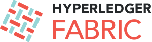

.. note:: Iltimos, o'zingiz foydalanayotgan dasturiy ta'minot versiyasiga mos
	  hujjatlarni o'qiyotganingizga ishonch hosil qiling. Versiya belgisi
	  chap tomondagi navigatsiya panelining yuqori qismida ko'rsatilgan.
	  Uni navigatsiya panelining pastki qismidagi tanlagich orqali
	  o'zgartirishingiz mumkin.

Korxonalar uchun blokcheyn platformasi
======================================

Korporativ darajadagi ruxsatli taqsimlangan reestr platformasi. U modulli
va moslashuvchan bo'lib, turli sohalardagi keng ko'lamli vazifalarga
mos keladi.

.. toctree::
   :maxdepth: 1

   whatis
   whatsnew
   key_concepts
   getting_started
   getting_started_run_fabric
   tutorials
   deployment_guide_overview
   ops_guide
   upgrade
   command_ref
   architecture
   Fabric-FAQ
   CONTRIBUTING
   glossary
   releases
   questions
   status

.. note:: Agar sizda ushbu hujjatlarda javob topilmagan savollar bo'lsa yoki
          qo'llanmalardan birida muammoga duch kelsangiz, qo'shimcha yordamni
          qayerdan topish mumkinligi haqida maslahatlar uchun :doc:`questions`
          sahifasiga tashrif buyuring.

.. Licensed under Creative Commons Attribution 4.0 International License
   https://creativecommons.org/licenses/by/4.0/
